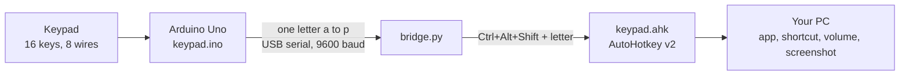

# Keypad Macropad

A 4x4 keypad on an Arduino Uno that launches apps and fires shortcuts on Windows. Change what any key does by editing one line of text. The Uno is never reflashed.

**Website:** https://tonylikedev.github.io/keypad-macropad/ (live once GitHub Pages is on: Settings, Pages, deploy from branch `main`, folder `/docs`)

## How it works



1. The Uno scans the keypad and sends one letter per press (`a` to `p`). Holding a key repeats it as an uppercase letter.
2. `bridge.py` reads the letter and presses `Ctrl+Alt+Shift` plus that letter.
3. `keypad.ahk` catches that combination and runs the action for the key.

## Key map

The keypad's printed labels run S1 to S16 and map onto the letters `a` to `p` in order. Rows run across and columns run down, as the keypad is held.

| | Col 1 | Col 2 | Col 3 | Col 4 |
|---|---|---|---|---|
| **Row 1: windows** | S13 (`m`) Lock PC | S9 (`i`) Show desktop | S5 (`e`) Task view | S1 (`a`) Task manager |
| **Row 2: apps** | S14 (`n`) Browser | S10 (`j`) File Explorer | S6 (`f`) VS Code | S2 (`b`) Calculator |
| **Row 3: editing** | S15 (`o`) Copy | S11 (`k`) Paste | S7 (`g`) Undo | S3 (`c`) Screenshot |
| **Row 4: media** | S16 (`p`) Play / pause | S12 (`l`) Volume down | S8 (`h`) Volume up | S4 (`d`) Mute |

Volume up and volume down repeat while held. S3 saves a PNG of the monitor under the mouse to `Pictures\Screenshots` and copies it to the clipboard.

## Wiring

| Keypad pin | Role | Uno pin |
|---|---|---|
| 1 | Row 1 | D9 |
| 2 | Row 2 | D8 |
| 3 | Row 3 | D7 |
| 4 | Row 4 | D6 |
| 5 | Column 1 | D5 |
| 6 | Column 2 | D4 |
| 7 | Column 3 | D3 |
| 8 | Column 4 | D2 |

No resistors are needed, because the Keypad library uses the Uno's internal pull-ups. Keep **D0 and D1 empty**: a wire there makes sketch uploads fail with "not in sync".

If a key sends the wrong letter, upload `diag/diag.ino`. It prints which two pins a key connects.

## Quick start

You need an Arduino Uno R3, a 4x4 membrane keypad, eight jumper wires and a Windows PC. Start with `git clone https://github.com/TonyLikeDev/keypad-macropad.git`, then:

1. **Wire** the keypad as above.
2. **Upload** the sketch (replace `COM3` with your port):
   ```
   arduino-cli lib install Keypad
   arduino-cli compile --upload -p COM3 --fqbn arduino:avr:uno keypad
   ```
3. **Install** the PC side:
   - `pip install pyserial`
   - Download the portable [AutoHotkey v2](https://www.autohotkey.com/) zip and unzip it into `tools\autohotkey` (so `tools\autohotkey\AutoHotkey64.exe` exists).
   - `start_keypad.cmd` starts Python from `%LOCALAPPDATA%\Microsoft\WindowsApps\pythonw3.11.exe`. If your Python lives elsewhere, edit that line.
4. **Run** `start_keypad.cmd`. Press S2 and Calculator opens.

`stop_keypad.cmd` stops everything. Run it before uploading a new sketch, because the bridge holds the COM port.

## Customize

Each key is one line in `keypad.ahk`:

```
^!+b::Run "calc.exe"                    ; S2  calculator
^!+g::Tap "^z"                          ; S7  undo
^!+l::Tap "{Volume_Down 3}"             ; S12 volume down
```

`^!+` means Ctrl+Alt+Shift and the letter is the key. Edit a line, then run `start_keypad.cmd` again to reload.

To make a key repeat while held, add its letter to `REPEAT` at the top of `bridge.py`.

## Repository

| Path | What it is |
|---|---|
| `keypad/keypad.ino` | Uno sketch: scans the keypad, sends letters |
| `bridge.py` | Turns letters into Ctrl+Alt+Shift combinations |
| `keypad.ahk` | The key map: what each key does |
| `screenshot.ps1` | Screenshot of the monitor under the mouse, used by S3 |
| `start_keypad.cmd`, `stop_keypad.cmd` | Start and stop the PC side |
| `diag/` | Wiring diagnostic |
| `docs/` | The project website (GitHub Pages) |
| `plan.md` | The original plan plus the build log and findings |

## What did not work

The first plan was to make the Uno a real USB keyboard by reflashing its USB chip (ATmega16U2). The original firmware downloads are dead, so it was rebuilt from source for the 16U2, but on this board the chip would not enter DFU mode: it reset, then came back as a normal Uno, and nothing was written. The serial bridge replaced it and turned out simpler. The full story is in `plan.md` and on the project website.

## Limits

- Windows only. `bridge.py` and `keypad.ahk` use Windows features. The Uno sketch works anywhere.
- The bridge and AutoHotkey must be running for keys to do anything.
- Pressing two keys at once drops the chord.
- AutoHotkey cannot trigger actions over elevated (administrator) windows.

## Credits

[Keypad library](https://github.com/Chris--A/Keypad) by Mark Stanley and Alexander Brevig, [pyserial](https://github.com/pyserial/pyserial), [AutoHotkey](https://www.autohotkey.com/) v2 and [arduino-cli](https://github.com/arduino/arduino-cli). The abandoned USB-keyboard route used source by Darran Hunt, built on the LUFA library.
