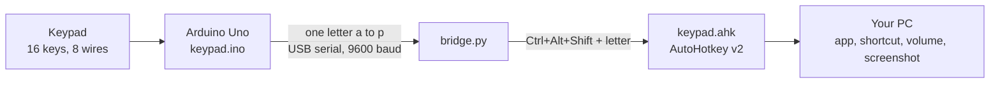

# Keypad Macropad

A 4x4 keypad on an Arduino Uno that launches apps and fires shortcuts on Windows. Change what any key does by editing one line of text. Remapping never needs a re-upload to the Uno, and the Uno's USB chip is never reflashed.

**Website:** https://tonylikedev.github.io/keypad-macropad/ (live once GitHub Pages is on: Settings, Pages, deploy from branch `main`, folder `/docs`)

## How it works



1. The Uno scans the keypad and sends one letter per press (`a` to `p`). Holding a key repeats it as an uppercase letter.
2. `bridge.py` reads the letter and presses `Ctrl+Alt+Shift` plus that letter.
3. `keypad.ahk` catches that combination and runs the action for the key.

## Key map

The keypad's printed labels run S1 to S16 and map onto the letters `a` to `p` in order. The table shows the keypad as held, with S1 at the top right.

| | Col 1 | Col 2 | Col 3 | Col 4 |
|---|---|---|---|---|
| **Top row: windows** | S13 (`m`) Lock PC | S9 (`i`) Show desktop | S5 (`e`) Task view | S1 (`a`) Task manager |
| **Second row: apps** | S14 (`n`) Browser | S10 (`j`) File Explorer | S6 (`f`) VS Code | S2 (`b`) Calculator |
| **Third row: editing** | S15 (`o`) Copy | S11 (`k`) Paste | S7 (`g`) Undo | S3 (`c`) Screenshot |
| **Bottom row: media** | S16 (`p`) Play / pause | S12 (`l`) Volume down | S8 (`h`) Volume up | S4 (`d`) Mute |

- Volume up and volume down repeat while held.
- S3 saves a PNG of the monitor under the mouse to `Pictures\Screenshots` and copies it to the clipboard.
- S4 toggles mute, so it also unmutes.
- S14 opens `https://www.google.com` in your default browser. It is a URL in `keypad.ahk` you can change.
- S6 assumes the per-user VS Code install (`%LOCALAPPDATA%\Programs\Microsoft VS Code`). Edit its line if yours is elsewhere.
- Only the four corners (S1, S4, S13, S16) were checked by position. The rest follow the pattern. If a key seems off, use the wiring diagnostic below.

## Wiring

The keypad's matrix has four rows and four columns, so eight wires. S1 to S4 sit on one matrix row, which is the right-hand column as you hold the pad.

| Keypad pin | Role | Uno pin |
|---|---|---|
| 1 | Matrix row 1 | D9 |
| 2 | Matrix row 2 | D8 |
| 3 | Matrix row 3 | D7 |
| 4 | Matrix row 4 | D6 |
| 5 | Matrix column 1 | D5 |
| 6 | Matrix column 2 | D4 |
| 7 | Matrix column 3 | D3 |
| 8 | Matrix column 4 | D2 |

No resistors are needed, because the Keypad library uses the Uno's internal pull-ups. Keep **D0 and D1 empty**: they carry the Uno's serial link, and a wire there can make sketch uploads fail with "not in sync".

**Wiring diagnostic.** If a key sends the wrong letter, upload `diag/diag.ino` the same way as the main sketch, then run `python diag/read_diag.py COM3` (with the bridge stopped) and press the keys. It prints which two pins each key connects. Upload `keypad/keypad.ino` again afterwards.

## Quick start

You need a genuine Arduino Uno R3 (the bridge finds the board by Arduino's USB ID), a 4x4 membrane keypad, eight jumper wires, and a Windows PC with Python 3.

1. **Get** the project and open a terminal in its folder:
   ```
   git clone https://github.com/TonyLikeDev/keypad-macropad.git
   cd keypad-macropad
   ```
2. **Wire** the keypad as above.
3. **Upload** the sketch. Install [arduino-cli](https://arduino.github.io/arduino-cli/latest/installation/) first, then replace `COM3` with your port (`arduino-cli board list` shows it):
   ```
   arduino-cli core update-index
   arduino-cli core install arduino:avr
   arduino-cli lib install Keypad
   arduino-cli compile --upload -p COM3 --fqbn arduino:avr:uno keypad
   ```
4. **Install** the PC side:
   - `pip install pyserial`
   - [AutoHotkey v2](https://www.autohotkey.com/): either the normal installer, or the portable zip unzipped into `tools\autohotkey` (so `tools\autohotkey\AutoHotkey64.exe` exists).
5. **Run** `start_keypad.cmd`. Press S2 and Calculator opens.

`start_keypad.cmd` looks for the portable AutoHotkey, then the installed one, and for the Microsoft Store Python (`pythonw3.11.exe`), then any `pythonw` on your PATH. If nothing happens, run `python bridge.py` in a terminal: it prints each letter as you press keys.

`stop_keypad.cmd` stops everything. Run it before uploading a new sketch, because the bridge holds the COM port.

## Customize

Each key is one line in `keypad.ahk`:

```
^!+b::Run "calc.exe"                    ; S2  calculator
^!+g::Tap "^z"                          ; S7  undo
^!+l::Tap "{Volume_Down 3}"             ; S12 volume down
```

`^!+` means Ctrl+Alt+Shift and the letter is the key. Edit a line, then run `start_keypad.cmd` again to reload.

To make a key repeat while held, add its letter to `REPEAT` at the top of `bridge.py`.

## Repository

| Path | What it is |
|---|---|
| `keypad/keypad.ino` | Uno sketch: scans the keypad, sends letters |
| `bridge.py` | Turns letters into Ctrl+Alt+Shift combinations |
| `keypad.ahk` | The key map: what each key does |
| `screenshot.ps1` | Screenshot of the monitor under the mouse, used by S3 |
| `start_keypad.cmd`, `stop_keypad.cmd` | Start and stop the PC side |
| `diag/` | Wiring diagnostic |
| `docs/` | The project website (GitHub Pages) |
| `plan.md` | The original plan plus the build log and findings |

## What did not work

The first plan was to make the Uno a real USB keyboard by reflashing its USB chip (ATmega16U2). The original firmware downloads are dead, so it was rebuilt from source for the 16U2, but on this board the chip would not enter DFU mode: it reset, then came back as a normal Uno, and nothing was written. The serial bridge replaced it and turned out simpler. The full story is in `plan.md` and on the project website.

## Limits

- Windows only. `bridge.py` and `keypad.ahk` use Windows features. The Uno sketch works anywhere.
- Nothing starts at login yet: run `start_keypad.cmd` after each boot. Recovery after unplugging and replugging the Uno has not been tested.
- The bridge and AutoHotkey must be running for keys to do anything.
- Two keys at once are not supported.
- AutoHotkey cannot trigger actions over elevated (administrator) windows.
- Clone boards with a CH340 or similar USB chip use a different USB ID. Change the `0x2341` check in `find_port()` in `bridge.py` if you have one.

## Credits

[Keypad library](https://github.com/Chris--A/Keypad) by Mark Stanley and Alexander Brevig, [pyserial](https://github.com/pyserial/pyserial), [AutoHotkey](https://www.autohotkey.com/) v2 and [arduino-cli](https://github.com/arduino/arduino-cli). The abandoned USB-keyboard route used source by Darran Hunt, built on the LUFA library.
